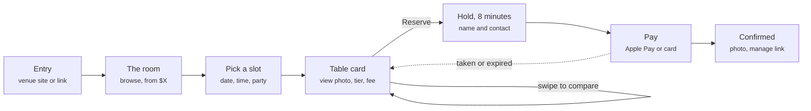
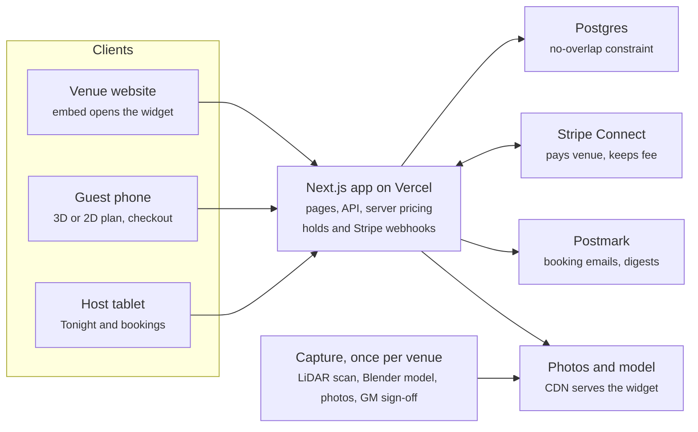

# PRD - Pick-Your-Table Prototype

Version 0.3 · Oct 22, 2026 · Sponsor: Justin T. McCain

## Summary

We are building a working prototype of a guest-facing table picker. A guest explores an accurate 3D model of a dining room, taps a table, sees the view from that seat, and pays to guarantee it. The venue runs it from a host-stand portal.

The prototype answers one question: can we build this at a quality that earns further investment? Engineering owns that call, using the build gate at the end of this document. Every product question is decided below, and each decision is a configuration value, so changing one later is an edit, not a rewrite.

**Deliverable:** a deployed web app with:

- the guest booking flow for a to-scale demo venue;
- the operator portal;
- a venue data pipeline that loads a real scanned venue with no code changes;
- Stripe running end to end in test mode.

| Field | Value |
| --- | --- |
| Owner and gate | Product and engineering lead |
| Sponsor | Justin T. McCain |
| Status | Approved for build |
| Version | 0.3 |
| Track | Standard software; handles payments and personal data, test mode only |

## Product decisions

These are final for the prototype; nothing waits on anyone.

| Area | Decision | Why |
| --- | --- | --- |
| Venue | Build against **Halcyon**, a fictional 20 × 12 m waterfront dining room authored to scale in meters. Real venues load later through the same `venue.json`. | Starts the build now and proves the data contract |
| Tables | 6 Window two-tops on the north glass; 4 curved Booths (4 seats) on the east wall; a chef's Counter as 3 two-seat units; 4 Terrace four-tops outside west sliding doors; 8 Standard tables shown but not bookable | Four tiers that look different in 3D and from the seat |
| Fees, weeknight / weekend | Window $25 / $40; Booth $20 / $30; Counter $15 / $25; Terrace $20 / $35 | Wide enough spread to exercise tiers and price display |
| View from the seat | Pre-rendered at build time from each seat at 1.15 m eye height, labeled "Preview render". A real photo replaces it by photo ID with no code change. | Honest, crisp and fast on day one |
| Dayparts | Dinner 17:00 to 22:00 daily; Lunch 11:30 to 14:30 Friday to Sunday; slots every 15 minutes | Realistic shape for availability logic |
| Turn time | 90 min for 1 to 2 guests, 120 min for 3 to 4, 150 min for 5 to 6 | Standard restaurant turns |
| Hold | 8 minutes, one visible countdown, released on expiry | Long enough to pay, short enough to stop squatting |
| Refunds | Full refund 24 h or more ahead; none under 24 h or for no-shows; automatic full refund if the venue seats the guest elsewhere | Simple and enforceable in code |
| Fee and bill | A separate charge, not credited to the food bill | One payment flow, no point-of-sale link |
| Payments | Stripe Connect, test mode only; destination charge with a 30% application fee (config value) | The real money flow without real money |
| Guest identity | No accounts; one signed manage link per booking | Least data, least friction |
| Operator sign-in | Magic link; Owner and Host roles | No passwords to store |
| Notifications | Email only, through a Postmark adapter; a dev inbox page in development | SMS adds carrier setup with no prototype value |
| Branding | The guest sees the venue's name, colors and type only; Pick-Your-Table is the internal codename | Venues sell their room, not our logo |
| Typography | Instrument Serif for venue and table names; Geist Sans for interface text | Distinct and legible, both free |
| Platforms | Mobile web first (390 px wide); tablet-first operator portal; desktop supported; no native apps | Guests book on phones; hosts use tablets |
| Language | English only | One copy deck to polish |

## Scope and who we design for

The prototype is the full booking loop for one venue, guest side and host side, built to production quality on the paths it covers.

| Who | Moment | What the software must give them |
| --- | --- | --- |
| Occasion planner | Booking an anniversary dinner on a phone, a few weeks out | See the exact table and the view, lock it, never be surprised at the door |
| Business host | Booking a client dinner | A quiet booth, a receipt, no back-and-forth |
| Host at the stand | 7:45 pm on a Friday, line at the door | One glance shows which tables are paid and who sits there |
| Owner | Setting up and pricing tables | Control of tiers, fees, blackouts and refunds in a few taps |

**In:** the guest flow from entry to confirmed booking and self-serve cancel; the operator portal; the venue data pipeline (`venue.json`, optional model file, photo slots); payments in Stripe test mode; email; deployment to a public URL.

**Out of the prototype:**

- Live payments, real guests, and any real venue going live.
- Integrations with existing reservation systems.
- A self-serve layout editor; venues are authored as data.
- A marketplace or more than one venue in the guest UI.
- Guest accounts, loyalty, reviews, menus, pre-orders, add-ons.
- Dynamic pricing, SMS, analytics dashboards.
- Gaussian splats, 360° tours, native apps, languages other than English.

## Guest experience

The guest falls for a table first, then locks it in under two minutes on a phone. Four rules drive every screen: show the room before asking for a time, make the seat view the hero, ask for one decision per screen, and never surprise anyone on price.



If the table is taken or the hold runs out, the guest lands back on the table card with the most similar free table offered.

1. **Entry.** A direct venue URL, or a "Choose your table" button embedded on the venue's site that opens the widget full screen.
2. **The room.** The plan opens on the whole room in browse mode. Each bookable table shows its tier and "from $X". A sticky header holds date, time and party size.
3. **Pick a slot.** Setting date, time and party size applies live availability: available, taken, or wrong size for the party. Tapping a dimmed table says why.
4. **Table card.** A bottom sheet with the full-bleed seat view, tier name, up to 3 attribute chips (window, booth, wheelchair accessible), seat count and fee. The button reads "Reserve this table - $25". Swiping moves to the next available table, and the camera follows.
5. **Sit here.** From the card, the camera flies to the seat at 1.15 m eye height facing the table's main view, then returns. Reduced-motion users get a cut instead.
6. **Hold and pay.** An 8-minute hold with a visible countdown. Fields: name, email, mobile, occasion (optional), note. Apple Pay, Google Pay or card.
7. **Confirmed.** The seat view, date, time, party, an add-to-calendar file and a manage link, also sent by email.
8. **Manage.** One link, no account: view or cancel, with the policy refund shown before the guest confirms.

| State | What the guest sees |
| --- | --- |
| Loading | The 2D plan paints first; 3D fades in over it. Never a spinner on a blank screen. |
| No free premium table in the slot | The 3 nearest times with a free table of the same tier |
| Table taken between viewing and holding | "Someone just took this table" plus the most similar free table |
| Hold expired | Table released; one tap re-holds it if still free |
| Payment declined | Hold kept; the reason in plain words; try another method |
| No WebGL, low-end device, screen reader | 2D plan and list view with the same flow and seat views |
| Offline | "You're offline - your hold is safe for 6:42" with a retry |

## Operator portal

The portal is tablet-first because it lives at the host stand, and it is held to the same design bar as the guest side. A host must never seat a paid table wrong.

| Screen | Role | What it does |
| --- | --- | --- |
| Tonight | Host | The room plan with tonight's paid tables pinned, a time-ordered list with guest name, party, occasion, note and a PAID badge; mark Seated or No-show; printable run sheet |
| Bookings | Host, Owner | Upcoming paid bookings, search, cancel with refund, resend confirmation |
| Tables and pricing | Owner | Per table: bookable on or off, tier, attributes; fees per tier and daypart; special-date overrides; turn times |
| Blackouts | Owner | Block a table for a date or time range |
| Venue review | Owner | Every table's position and seat view side by side for approval before the venue goes live |

Marking a guest Seated at a different table than the one they paid for triggers the automatic refund from Product decisions.

## Quality bar

If it looks wrong, it fails, so visual defects are P0 bugs. The room is drawn as a clean architectural diorama, but every position, view, price and availability state is literally true.

| Dimension | Standard | How it is checked |
| --- | --- | --- |
| Layout truth | The 3D plan, 2D plan and list place every table exactly where `venue.json` does; for a scanned venue, every table and wall within 30 cm of measured | Automated test compares positions across renderers; scan overlay for real venues |
| Diorama look | Cutaway walls about 1.1 m high; furniture at real proportions with soft bevels, never raw primitives; one matte clay material family plus the venue accent; ambient occlusion and soft contact shadows; no z-fighting, clipping, floating objects or popping | Screenshot review on the device matrix |
| Labels | Always upright and screen-aligned, scale-clamped, never overlapping | Rotate the camera through 360° at every zoom level |
| Camera | Default three-quarter view at about 35° field of view; pitch 25° to 70°; no view under the floor or through walls; transitions 400 to 600 ms, eased; damping on orbit | Manual test plus screenshot spec |
| Seat view | From the seat at 1.15 m, facing the table's main view, 26 mm full-frame equivalent field of view, never ultra-wide; real photos retouched for exposure and white balance only; no identifiable people | Render spec and photo log |
| Speed | 2D plan interactive in 2.5 s or less on Fast 4G (iPhone 13 profile); 3D in within 4 s; 60 fps on iPhone 13, 45 fps floor on Pixel 6a; tap response under 100 ms | Lighthouse and on-device profiling |
| Availability truth | Zero tables shown free that are taken | Concurrency test |
| Price truth | The price on the button is the total charged | Test bookings reconciled in Stripe |
| Interface | Body text 16 px or larger; tabular numerals for prices and times; light and dark mode each designed; no layout shift; no placeholder copy; no emoji; visible focus styles | Design review |
| Accessibility | WCAG 2.2 AA; full flow in list view with WebGL off; every table has a screen-reader label | Axe scan and a VoiceOver run |

**Table states** read at a glance with no legend:

| State | Treatment |
| --- | --- |
| Available | Full color with a thin tier-colored ring on the floor |
| Hovered or focused | Slight lift and a brighter ring |
| Selected | Lifts about 2 cm under a soft pool of light; every other table dims slightly |
| Taken | Desaturated to about 40% opacity, no ring |
| Wrong size for the party | Desaturated with a fine hatched ring; tapping explains why |

## Requirements

29 requirements: 22 must ship, 5 should, 2 later. Each has a binary check, and the build gate requires every P0 to pass.

| ID | Requirement | Priority | Acceptance check |
| --- | --- | --- | --- |
| G-1 | Plan loads from the venue URL | P0 | On an iPhone 13 profile over Fast 4G, the 2D plan is interactive in 2.5 s or less and 3D appears within 4 s |
| G-2 | Date, time and party size apply live availability | P0 | Every table shows available, taken or wrong size within 500 ms of a change |
| G-3 | Table card | P0 | Tapping an available table shows its seat view, tier, up to 3 attributes, seats and the server-computed fee |
| G-4 | Swipe to compare | P0 | Swiping the open card shows the next available table and moves the camera to it without closing the sheet |
| G-5 | Sit here | P0 | The camera reaches the seat at 1.15 m in 400 to 600 ms and returns; with reduced motion it cuts |
| G-6 | 8-minute hold | P0 | Two guests holding the same table and slot within 1 s: exactly one succeeds; the other sees the most similar free table |
| G-7 | Checkout with Apple Pay, Google Pay or card | P0 | A booking is confirmed only after Stripe reports success |
| G-8 | Confirmation screen and email | P0 | Email with the seat view and a calendar file arrives within 60 s of payment |
| G-9 | Cancel from the manage link | P0 | The refund amount shows before the guest confirms, and Stripe shows the matching refund |
| G-10 | List and 2D fallback | P0 | With WebGL off, the whole flow completes; Axe reports zero WCAG 2.2 AA violations |
| G-11 | Find times for this table | P1 | From a table card, the guest sees the next 5 free slots for that table |
| G-12 | Embed button for venue sites | P1 | One script tag adds the button and opens the widget full screen; checkout works from it |
| G-13 | Lighting that matches the chosen daypart | P2 | Not specified for this prototype |
| O-1 | Tonight screen | P0 | Every paid booking for today shows on the plan and list with a PAID badge; Seated and No-show update in under 2 s |
| O-2 | Bookings with cancel and refund | P0 | An owner refund appears in Stripe and emails the guest within 60 s |
| O-3 | Tables and pricing | P0 | A fee change applies to new holds only; existing bookings keep their price |
| O-4 | Blackouts | P0 | A blacked-out table shows as taken to guests within 10 s |
| O-5 | Booking and cancellation emails to the venue | P1 | Sent within 60 s of each event |
| O-6 | Venue review screen | P1 | The venue cannot go live until every table is approved |
| O-7 | Payouts screen | P2 | Not specified for this prototype |
| D-1 | Venue data contract | P0 | `venue.json` is schema-validated; a second fixture venue loads with no code change |
| D-2 | Venue model file slot | P1 | If a venue ships a GLB, the scene uses it; otherwise it builds the room from `venue.json` |
| D-3 | Real photo replaces a render | P0 | Adding a photo ID to a table swaps the seat view with no code change |
| S-1 | Prices computed on the server only | P0 | A tampered client price is ignored; the charge equals the server price |
| S-2 | No overlapping bookings per table | P0 | A database constraint rejects any overlapping hold or booking |
| S-3 | Payment after an expired hold | P0 | If the table was re-held, the payment is refunded within 5 min and the guest is emailed |
| S-4 | Abuse limits | P0 | At most 2 active holds per device and per email; Turnstile check before a hold |
| S-5 | Kill switch | P0 | Turning off `pyt_widget_enabled` hides the widget within 60 s and shows a fallback message |
| S-6 | Structured logs | P0 | Every hold, payment, webhook and refund writes one log line with IDs, amounts and outcome |

## Architecture

One venue file drives the 3D plan, the 2D plan, the list view and the seat renders, so they can never disagree. The server owns every price, hold and availability answer.



Stripe is the one two-way link: the app creates the payment, and Stripe's webhook confirms the booking.

| Layer | Choice | Why |
| --- | --- | --- |
| App | Next.js 15 (App Router), TypeScript strict, Tailwind CSS v4 with design tokens, on Vercel | One codebase for widget, portal and API |
| 3D | three.js through react-three-fiber and drei; N8AO ambient occlusion; camera-controls; chairs as instanced meshes | Full control of look, camera and performance |
| Labels | HTML overlays positioned from 3D, with a collision pass | Always upright, crisp text, accessible |
| 2D plan and list | SVG and HTML generated from `venue.json` | Paints before 3D loads and works without WebGL |
| Shared state | zustand store for selection, slot and party | 3D, 2D and list stay in sync |
| Data | Postgres (Docker locally, Neon deployed) with Drizzle and the `btree_gist` extension | The database itself prevents double booking |
| Payments | Stripe Connect, test mode, destination charges with an application fee; Stripe CLI for local webhooks | Real flow, no real money |
| Email | Postmark adapter; a `/dev/mail` inbox page in development | Testable without sending |
| Bot defense | Cloudflare Turnstile, test keys | Stops scripted hold-squatting |
| Seat renders | Rendered at build time by a headless browser from each seat, saved as AVIF and WebP | Sharp, light, identical to the live scene |
| Tests | Vitest for units; Playwright for end to end, screenshots and the concurrency race | Every gate check is a script |

**Venue data contract.** A venue is one folder: `venue.json`, an optional `model.glb`, and optional `photos/`. A shortened example:

```json
{
  "id": "halcyon",
  "demo": true,
  "name": "Halcyon",
  "timezone": "America/Los_Angeles",
  "room": { "width": 20, "depth": 12, "wallHeight": 1.1 },
  "tables": [
    {
      "id": "W1", "label": "Window 1", "tier": "window",
      "shape": "square", "seats": 2, "minParty": 1, "maxParty": 2,
      "x": 2.4, "z": 1.1, "rotation": 0,
      "view": { "yaw": 0, "pitch": -4 },
      "attributes": ["window", "water view"],
      "photoId": null
    }
  ]
}
```

**Capture pipeline for a real venue:**

1. Scan the room with RoomPlan on a LiDAR iPhone Pro; export USDZ.
2. Laser-measure 5 control distances to check the scan.
3. In Blender, rebuild clean geometry over the scan, apply the clay material set, bake ambient occlusion, export `model.glb`.
4. Write `venue.json` with each table's position, tier, attributes and main view.
5. Shoot each seat view on a tripod at 1.15 m, 26 mm equivalent, per daypart; add photo IDs.
6. The owner approves every table in Venue review.

| Budget | Limit |
| --- | --- |
| Venue model file | 3 MB or less (meshopt and KTX2 compression) |
| Initial JavaScript, compressed | 250 KB or less; three.js loads after the 2D plan |
| One seat view at phone width | 250 KB or less |
| 2D plan interactive, Fast 4G | 2.5 s or less |
| Frame rate | 60 fps on iPhone 13; 45 fps floor on Pixel 6a; device pixel ratio capped at 2 |

## Data, availability and payments

A booking is a time range on one table, and the database refuses any overlap. That is how we get zero double bookings by construction rather than by care.

| Entity | Key fields |
| --- | --- |
| Venue | id, name, timezone, Stripe account ID, dayparts, application fee % |
| Table | venue, label, tier, min and max party, attributes, photo ID, bookable flag (seeded from `venue.json`) |
| Price rule | tier, daypart, day type (weeknight, weekend, special date), fee in cents |
| Turn time | venue, party size range, minutes |
| Reservation | table, time range, status (held, confirmed, cancelled, expired, seated, no-show), hold expiry, guest, price, PaymentIntent ID |
| Guest | name, email, mobile, occasion, note |
| Blackout | table, time range, reason |
| Audit log | actor, action, reservation, amount, time |

**Availability:** slots start every 15 minutes inside dayparts, computed in the venue's timezone. A reservation occupies its start time plus the turn time for its party size. A table is free when the party fits and nothing overlaps.

```sql
CREATE EXTENSION IF NOT EXISTS btree_gist;
ALTER TABLE reservation ADD CONSTRAINT no_overlap
  EXCLUDE USING gist (table_id WITH =, during WITH &&)
  WHERE (status IN ('held', 'confirmed', 'seated'));
```

**Hold and pay sequence:**

1. In one transaction, expire this table's stale holds, then insert a `held` row expiring in 8 minutes. If the constraint fires, the guest lost the race and gets the most similar free table.
2. Create a Stripe PaymentIntent with the hold ID as metadata and idempotency key; the server sets the amount.
3. On the `payment_intent.succeeded` webhook, flip the hold to `confirmed`. Webhooks are idempotent and verified by signature.
4. A job every 30 s expires unpaid holds. A payment that lands after its hold expired and the table was re-held is refunded automatically, and the guest is emailed.
5. A nightly reconciliation compares confirmed reservations with Stripe and logs any mismatch.

## Privacy and security

Privacy is built in, not added later: we collect only what a booking needs, never touch card numbers, and keep no guest accounts. The prototype runs on test data only.

| Data | Purpose | Stored in | Retention | Who can see it |
| --- | --- | --- | --- | --- |
| Guest name, email, mobile | Booking and confirmation | Postgres | 24 months after the visit, then deleted by a scheduled job | The venue, for its own bookings; platform admins |
| Party size, occasion, note | Service at the table | Postgres | Same | Same |
| Card details | Payment | Stripe only; we keep PaymentIntent ID, brand and last 4 | Stripe's terms | Nobody at the venue or platform |
| Server logs | Debugging holds and payments | Hosting logs, no card data, emails masked | 30 days | Engineering |

**Controls:**

- Manage links are signed per booking and expire after the visit date.
- Card fields through Stripe Elements only (PCI SAQ A scope).
- Owner and Host roles enforced on the server; refunds and cancellations written to the audit log.
- Turnstile and hold limits against hold-squatting; Stripe Radar on.
- No third-party scripts in the widget beyond Stripe and Turnstile.
- Secrets only in environment settings; daily database backups.

**Red-team cases, each with an automated test:** a bot holding every premium table; a tampered client price; one guest's manage link used to cancel another booking; replayed or out-of-order Stripe webhooks; scraping availability at high rate.

## Build sequence

Five milestones in strict order, each closed by its own check, not a calendar. The room (M1) gets the most iteration because it is what people judge first.

| Milestone | Builds | Done when |
| --- | --- | --- |
| M0 Foundations | Repo, CI (lint, typecheck, tests), `venue.json` schema, Halcyon seed, database with the no-overlap constraint, deploy pipeline | A clean clone runs with one setup command; CI is green; a preview URL deploys |
| M1 The room | 3D diorama, 2D plan and list from one source; table states; labels; camera; Sit here; build-time seat renders | The screenshot loop passes at 390 × 844 and 1440 × 900 in light and dark; the speed budgets hold; the layout-truth test passes |
| M2 Book a table | Slots and availability API, table card with swipe, holds, Stripe checkout, confirmation, email, manage and cancel, every guest state | The demo script below runs end to end in test mode in under 90 seconds on a phone viewport |
| M3 Operator portal | Magic-link sign-in, roles, Tonight, Bookings, Tables and pricing, Blackouts | A guest booking appears on Tonight with a PAID badge within 2 s |
| M4 Hardening | Concurrency race, red-team tests, accessibility, device matrix, kill switch, structured logs, P1 items | Every P0 passes and the build gate report is written |

**Screenshot loop** (after every visual change):

1. Run the Playwright screenshot spec.
2. Review every image as a demanding product designer would: alignment, spacing, type, contrast, shadow quality, label legibility, motion.
3. Fix what is off and repeat. M1 takes at least three full passes.

**Demo script** (used by M2 and the gate):

1. Open the Halcyon link on a phone; the room appears.
2. Pick Friday, 8:00 pm, party of 2.
3. Tap Window 1; the seat view fills the sheet.
4. Tap Sit here, then swipe to Booth 2 to compare.
5. Reserve with Apple Pay in test mode; the confirmation shows the seat view.
6. Open the portal on a tablet: the booking is on Tonight with a PAID badge.

## The build gate

Engineering recommends further investment only if every check below passes. A check that still fails after two fix attempts means we recommend stopping, and the report names the reason.

- [ ] **Requirements:** every P0 acceptance check passes, each with its proof (test name, screenshot or recording).
- [ ] **Quality bar:** every row of the Quality bar passes on the device matrix (iPhone 13, iPhone 16 Pro, Pixel 6a, Galaxy A35, iPad, desktop Chrome and Safari) with zero open visual defects.
- [ ] **Demo script:** runs end to end in under 90 seconds on a real phone, three times in a row without a defect.
- [ ] **Concurrency:** 20 scripted races for one table and slot produce 20 single winners and 0 double bookings.
- [ ] **Money:** 20 test bookings, cancellations, refunds and expired holds reconcile to the cent in Stripe.
- [ ] **Usability:** 5 people who have never seen the product each find a window table for two and its seat view in 10 s or less, and complete a booking in 90 s or less, unaided.
- [ ] **Data contract:** a second fixture venue with a different layout loads, renders and books with no code change.
- [ ] **Design review:** an outside senior product designer reviews the recorded demo and would ship it as is, or lists only fixes that are then made.

The gate report lives at `docs/GATE_REPORT.md`: each check with pass or fail and its proof, the demo recording, the device screenshots, what surprised us, and a one-line recommendation: invest further, or stop.

## Technical risks

The hardest risk is visual: making a 3D room look premium at 60 fps on a mid-range phone. Each risk below has a mitigation built into the plan.

| Risk | Impact | Mitigation |
| --- | --- | --- |
| Mid-range Android GPUs drop frames with shadows and ambient occlusion | Janky camera; the room feels cheap | Instanced furniture, baked contact shadows, device pixel ratio capped at 2, adaptive quality that lowers effects before frame rate, 2D fallback |
| Labels collide or blur as the camera moves | Unreadable plan | Screen-space HTML labels with a collision pass; only the selected label shows when zoomed far out |
| Seat renders look flat next to real photos later | The seat view stops being the hero | Build-time renders with supersampling and higher-quality lighting than the live scene; the same field of view and eye height as the photo standard |
| Apple Pay inside an embedded iframe | Checkout fails from venue sites | Register the payment domain with Stripe; set `allow="payment"` on the iframe; if unsupported, checkout opens on our domain at the top level. Verified in M4 on Safari iOS. |
| Webhooks arrive late, twice or out of order | A paid guest without a booking, or a double charge | Idempotent handlers keyed on PaymentIntent ID, automatic refund path, nightly reconciliation |
| Timezone and daylight-saving errors in slot math | Wrong slots, wrong availability | All slot math in the venue's timezone with a tested library; tests cross the November and March clock changes |
| Real venue scans exceed the model budget | Slow first load | meshopt and KTX2 compression, a size check in CI that fails over 3 MB |
| 3D, 2D and list drift apart | Guests see different rooms | One `venue.json` source and an automated layout-truth test in CI |

**Change log:** v0.1 first draft. v0.2 rewritten for executive review. v0.3 refocused on the build: product decisions made, business framing removed, engineering owns the gate.
